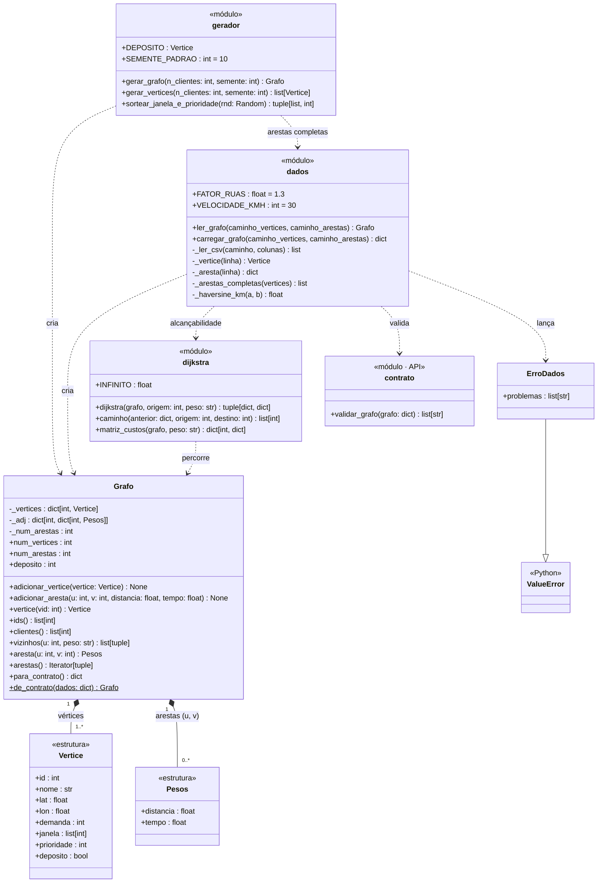
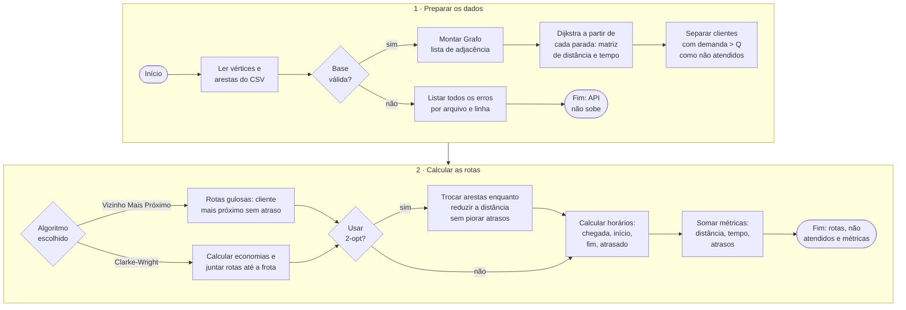

# Diagramas UML: modelagem do grafo (Dupla 1)

Os diagramas estão em [Mermaid](https://mermaid.js.org/), que o GitHub desenha sozinho ao abrir este arquivo.
Para gerar as figuras do relatório, siga as instruções de [diagramas.md](diagramas.md) (mermaid.live → *Actions → PNG*)
ou, com Node instalado, rode na raiz do repositório:

```bash
npx -p @mermaid-js/mermaid-cli mmdc -i docs/diagramas-grafo.md -o relatorio/figuras/uml-classes.png -w 1600 -s 2 -b white
```

---

## 1. Diagrama de classes
Arquivo da figura: `figuras/uml-classes.png`

O núcleo é a classe `Grafo` (`src/grafo/grafo.py`), que guarda o grafo não direcionado e ponderado em
lista de adjacência. `Vertice` e `Pesos` não são classes no código: são dicionários com os campos do
contrato da API (`src/api/contrato.py`). Aparecem aqui como `«estrutura»` para mostrar o que cada vértice
e cada aresta carregam. `dijkstra`, `dados` e `gerador` são módulos de funções, representados como `«módulo»`. O `gerador` cria
instâncias sintéticas (reprodutíveis pela semente) só para os testes e o benchmark; a base do sistema vem de `dados/`.



**Decisões que o diagrama mostra**
- **Lista de adjacência** (`_adj`): cada vértice aponta para os vizinhos e os pesos da aresta. A mesma
  estrutura `Pesos` é compartilhada pelos dois sentidos, já que a aresta não tem direção.
- **Dois pesos por aresta** (`distancia` em km e `tempo` em min): o Dijkstra e a matriz de custos
  escolhem qual usar pelo parâmetro `peso`.
- **Exatamente um depósito**: a propriedade `deposito` falha se houver zero ou mais de um.
- **Conversão pelo contrato** (`de_contrato` / `para_contrato`): o grafo entra e sai da API no mesmo
  formato JSON, então as outras duplas não dependem da classe por dentro.

---

## 2. Diagrama de atividades: cálculo de rotas (domínio do problema)
Arquivo da figura: `figuras/uml-atividades-rotas.png`

Este diagrama mostra o fluxo de dados do problema modelado (CVRPTW), da leitura do grafo até a
solução final — complementar ao diagrama de classes (estrutura estática) e ao diagrama de sequência
da interface (`diagramas.md`, que mostra a troca de mensagens entre API e front, não o algoritmo em si).

Desenhado na horizontal, em duas faixas (preparação dos dados e cálculo das rotas), para
ocupar pouca altura no relatório.



**Decisões que o diagrama mostra**
- A validação (`ErroDados`) acontece **antes** de montar o grafo, e lista todos os problemas de uma
  vez (não para no primeiro erro) — é o que o teste `test_registros_invalidos_listados_todos` cobra.
- A matriz de custos (Dijkstra) é calculada **uma única vez**, antes de escolher o algoritmo: as
  heurísticas de construção e o 2-opt trabalham só sobre essa matriz entre paradas, nunca sobre o
  grafo viário completo de novo.
- O 2-opt é condicional e vem **depois** da construção, nunca embutido nela — é por isso que a
  interface pode ligar e desligar o 2-opt sem trocar o algoritmo de construção.
