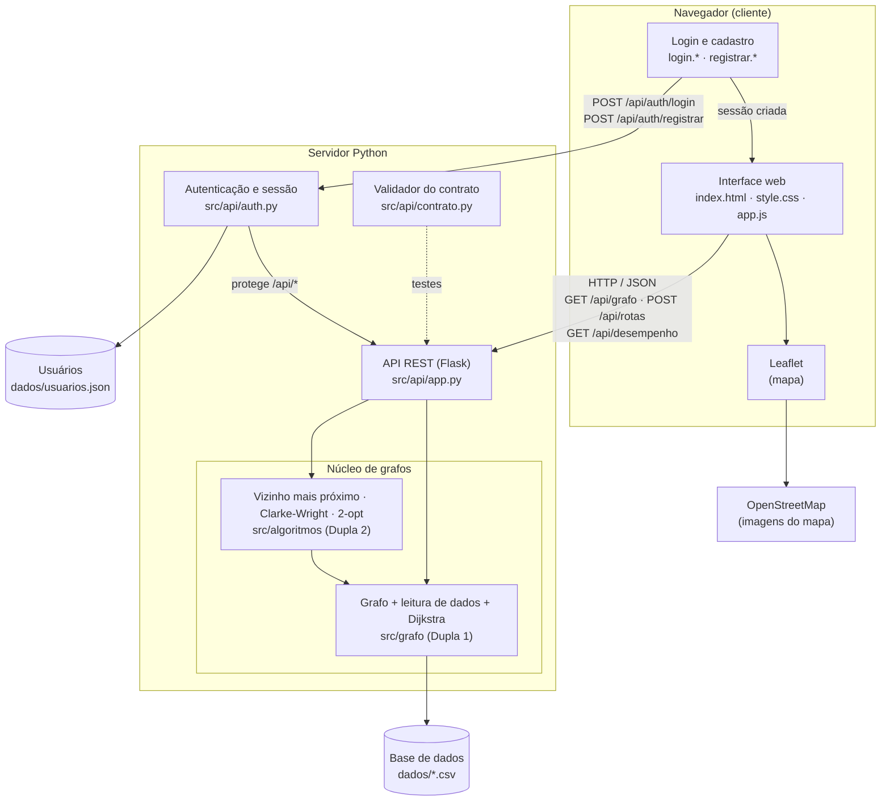
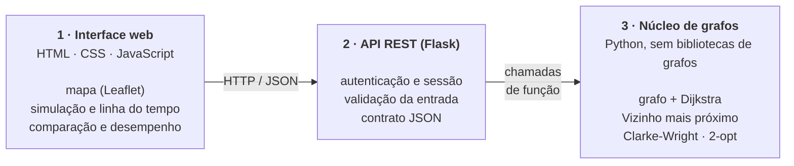
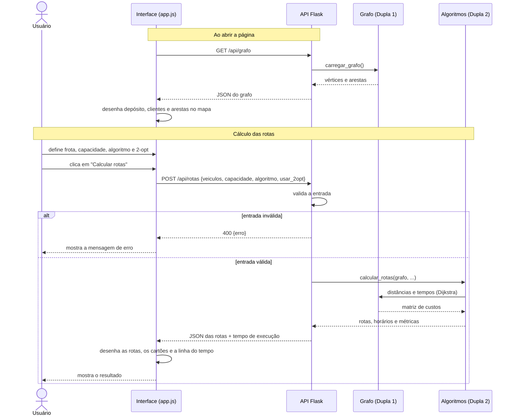
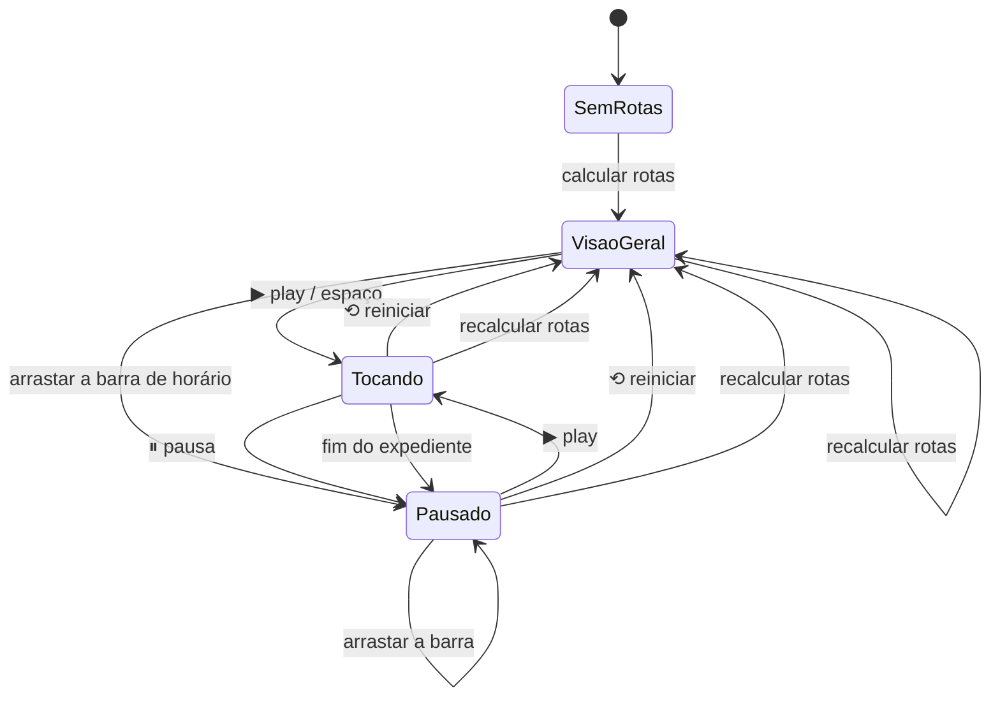
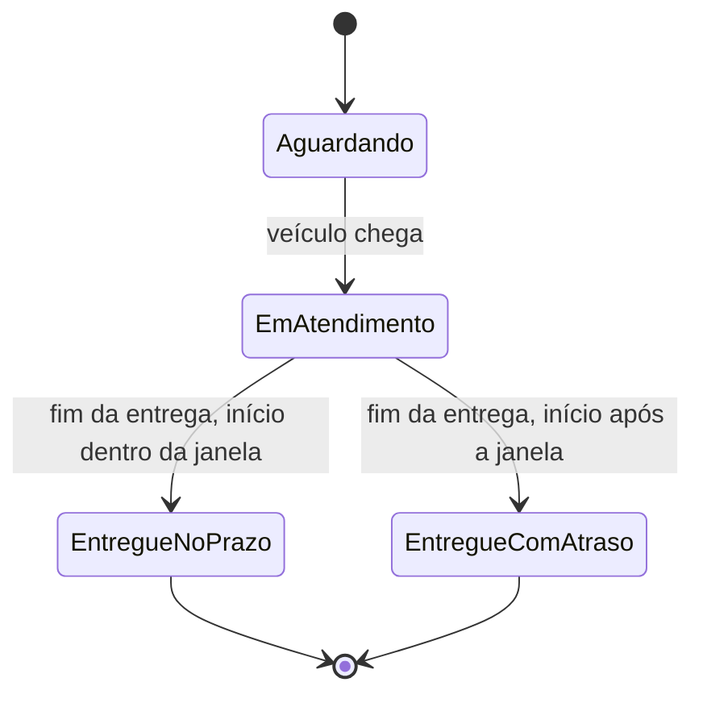

# Diagramas UML: arquitetura e interface (Dupla 3)

Os diagramas estão em [Mermaid](https://mermaid.js.org/), que o GitHub desenha sozinho ao abrir este arquivo.

**Para gerar as figuras do relatório:**
1. Cole o bloco em https://mermaid.live.
2. Clique em *Actions → PNG* (ou SVG).
3. Salve em `relatorio/figuras/` com o nome indicado em cada seção.

Os diagramas da **modelagem do grafo** (classes do grafo, casos de uso, atividades) são responsabilidade da Dupla 1.

---

## 1. Diagrama de componentes
Arquivo da figura: `figuras/uml-componentes.png`

---

## 1b. Arquitetura em camadas
Arquivo da figura: `figuras/arquitetura.png`

---

## 2. Diagrama de sequência: calcular rotas
Arquivo da figura: `figuras/uml-sequencia.png`

---

## 3. Diagrama de estados: simulação do dia
Arquivo da figura: `figuras/uml-estados-simulacao.png`

Estado de cada cliente durante a simulação:

---

## 4. Diagrama de casos de uso da interface
Arquivo da figura: `figuras/uml-casos-uso-interface.png`

O Mermaid não tem um tipo próprio para casos de uso, por isso o diagrama abaixo é uma aproximação. Se a Dupla 1 já fizer o diagrama de casos de uso oficial (no draw.io, por exemplo), basta incluir estes casos nele.

```mermaid
flowchart LR
    U(("👤 Planejador<br/>logístico"))
    U --> C1(["Visualizar o grafo no mapa"])
    U --> C2(["Configurar a frota"])
    U --> C3(["Calcular rotas"])
    U --> C4(["Inspecionar uma rota"])
    U --> C5(["Simular o dia"])
    U --> C6(["Comparar algoritmos"])
    U --> C7(["Medir desempenho"])
    U --> C8(["Exportar resultado"])
    U --> C9(["Consultar o guia de uso"])
    C3 -. include .-> C2
    C5 -. include .-> C3
    C4 -. extend .-> C3
```

